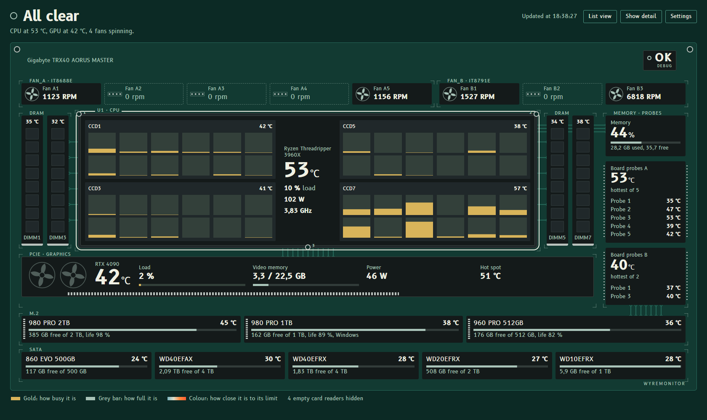
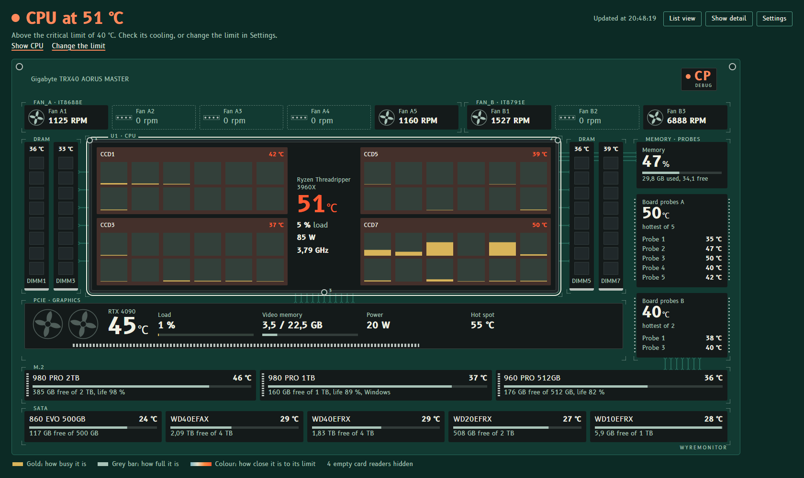
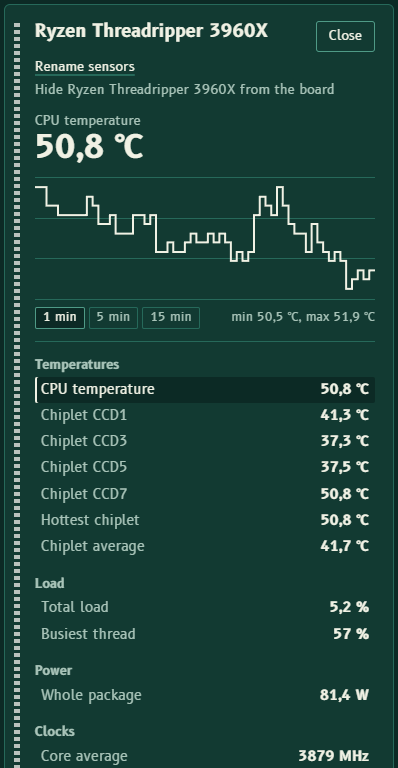

<h1 align="center">
  <br />
  WyreMonitor
</h1>

<p align="center">
  A hardware monitor for Windows that draws your PC as a circuit board<br />
  and tells you in one sentence whether anything needs attention.
</p>

<p align="center">
  <a href="../../releases/latest"></a>
  <a href="LICENSE"></a>
  
  <a href="../../releases"></a>
</p>



## Why another hardware monitor?

Most monitors show a long list of sensors and leave the reading to you. WyreMonitor puts each
part where it sits on the board and answers the question you opened it for:

- **A verdict on top.** "All clear", or a short list of what needs checking, most serious
  first. Click an item to jump to that part.
- **Limits per part.** Colour shows how close each reading is to *that part's* limit:
  45 °C is fine for a CPU and a lot for a hard disk.
- **The real layout.** Ryzen and Threadripper chiplets each get their own temperature, and every
  thread has its own load bar. Memory modules sit beside the socket, drives below.
- **Every sensor, when you want it.** Click any part to see all its readings and a 60-second chart.

<p align="center">
  <br />
  <sub>How alerts look. The values in this picture were changed by hand to show them.</sub>
</p>

## Features

- CPU temperature, load, power and clock, with per-chiplet temperature and per-thread load
- Graphics cards: temperature, hot spot, load, video memory, power and fans. A laptop's integrated
  and discrete GPUs appear side by side
- Motherboard fans and temperature probes, memory modules with their temperature
- Drives: temperature, used space and SSD remaining life
- Battery charge and charging state on laptops
- Alerts for high temperatures, stopped fans, worn SSDs and a nearly full Windows drive
- Own window and an icon next to the clock. It starts with Windows and opens without UAC prompts
- No network access: the page is served only on `127.0.0.1`

Parts a PC doesn't report are left out of the drawing instead of showing up empty.

<p align="center">
  
</p>

## Install

1. Download `WyreMonitor-Setup-<version>.exe` from the [latest release](../../releases/latest).
2. Check the download if you like: the release notes list its SHA-256, and
   `Get-FileHash .\WyreMonitor-Setup-<version>.exe` in PowerShell prints the one you have.
3. Run it. The installer is not code-signed yet, so Windows may show "Windows protected your PC":
   choose **More info**, then **Run anyway**.
4. Open WyreMonitor from the Start menu.

WyreMonitor has two parts:

- **The WyreMonitor service** reads the sensors. It runs in the background as a Windows service,
  starts with Windows, and serves the data on `127.0.0.1` only. When no window has shown the data
  for a minute, it stops reading the sensors until one does.
- **The app** shows the window and the icon next to the clock. It runs with your normal rights,
  never as administrator.

The installer puts both in `C:\Program Files\WyreMonitor`, with the .NET runtime included. If
[PawnIO](https://github.com/namazso/PawnIO.Setup) is missing, it downloads a fixed version from
its official releases, checks the file's SHA-256, then installs it.

Closing the window keeps the app next to the clock. **Exit** in the icon's menu quits it, and
**Start with Windows** turns the icon at sign-in on or off.

**Uninstall** from Windows Settings › Apps. This removes the app, the service and their settings.
PawnIO stays, since other programs may use it. The window's browser data stays in
`%LOCALAPPDATA%\WyreMonitor`, and you can delete that folder yourself.

### Requirements

- Windows 10 (1809 or later) or Windows 11, 64-bit
- Microsoft Edge WebView2 Runtime, included in Windows 11 and in most Windows 10 installs
- An administrator account, to install it

## FAQ

**Why does it need administrator rights?**
Reading CPU temperatures, fans and motherboard probes goes through a kernel driver, which only
administrators can use. You confirm once, when installing. From then on only the WyreMonitor
service uses the driver, as a standard Windows service. The app you see runs with your normal
rights, so opening it never asks for confirmation.

**Is the service safe to leave running?**
It only reads sensors and listens on `127.0.0.1`, so other computers cannot reach it. It refuses
requests addressed to any other host name, which blocks web pages that try to reach it through
their own domain. It takes no settings from your user account, and writes only its port number,
to a registry key that only administrators can change. With no window open for a minute it stops
reading the sensors and uses almost no CPU.

**Does it work on laptops?**
Yes for CPU, graphics, memory, drives and battery. Most laptops don't expose their fans and board
probes, so those parts simply don't appear.

**Can it control fan speeds?**
No, WyreMonitor only reads sensors. For fan curves, look at
[Fan Control](https://github.com/Rem0o/FanControl.Releases).

**My antivirus flags it. Is it safe?**
The source code is all here and you can build it yourself. WyreMonitor uses PawnIO, a signed
driver that works with Windows Memory Integrity turned on, instead of the old WinRing0 driver
that many antivirus programs block. Some antivirus programs still distrust new apps that install
a service and use a driver.

**Does it send any data?**
No. It talks only to your own hardware and serves its page on `127.0.0.1`, which other
computers cannot reach.

**A sensor is missing or reads wrong. What can I do?**
WyreMonitor reads sensors through [LibreHardwareMonitor](https://github.com/LibreHardwareMonitor/LibreHardwareMonitor),
so hardware support depends on it. Problems with missing or wrong readings belong there. Problems
with how WyreMonitor shows them belong in this repository's [issues](../../issues).

**Can I show temperatures in Fahrenheit?**
Not yet.

## Build from source

You need the .NET 10 SDK, and Inno Setup 6 for the installer.

```powershell
dotnet build -c Release            # build
.\Start-WyreMonitor.ps1            # build into dist\ and run service + app (stops the installed ones)
.\Build-Installer.ps1              # installer in installer\output\
```

<details>
<summary>Publishing a release</summary>

The version is written only in `<Version>` in `WyreMonitor.csproj`. The installer reads it from
there, and the app shows it in the icon's menu.

```powershell
winget install --id JRSoftware.InnoSetup -e
winget install --id GitHub.cli -e
gh auth login
.\Publish-Release.ps1 -Version 1.1.0
```

`Publish-Release.ps1` checks that everything is committed and pushed, sets the version, builds
the installer, tags the commit and creates a GitHub release with the installer attached. The
release notes list the commits since the previous version; `-Notes "..."` replaces them.

</details>

<details>
<summary>How it works</summary>

| Part | Files | Role |
|---|---|---|
| Entry point | `Program.cs` | One executable: `--service` runs the service, no argument runs the app. |
| Sensors | `Hardware/` | Reads LibreHardwareMonitor in the background, each part at its own pace, and publishes an immutable snapshot with a 60-second history per sensor. |
| Service | `Service/` | Windows service (LocalSystem). Serves the page and a read-only `/api/sensors` on `127.0.0.1`, port 5005 or the next free one up to 5014, and writes the port to `HKLM\SOFTWARE\WyreMonitor`. |
| App | `Desktop/` | Runs with the user's rights: WebView2 window locked to the service's page, icon next to the clock, single instance, start at sign-in through the user's Run key. |
| Page | `wwwroot/` | The board drawing, the alerts and the detail panel. Plain HTML, CSS and JavaScript, no external requests. |
| Installer | `installer/`, `Build-Installer.ps1` | Inno Setup script: files, service, PawnIO (pinned version, SHA-256 checked). |

Security choices:

- **Rights:** the service is the only part with administrator rights. It accepts no input that a
  normal user could change: no command-line or environment configuration, no files in user
  folders, and .NET startup hooks are turned off.
- **Server:** listens only on `127.0.0.1`, accepts only the `127.0.0.1` and `localhost` host names
  (which blocks DNS rebinding), and sends a strict Content-Security-Policy.
- **Window:** the app's window can't navigate elsewhere, open new windows or use developer tools.

</details>

## Built with

| Library | Used for |
|---|---|
| [LibreHardwareMonitor](https://github.com/LibreHardwareMonitor/LibreHardwareMonitor) | Reading every sensor |
| [PawnIO](https://github.com/namazso/PawnIO.Setup) | Signed driver for CPU and motherboard sensors |
| [Microsoft Edge WebView2](https://developer.microsoft.com/microsoft-edge/webview2/) | The window |
| [B612](https://github.com/polarsys/b612) | Typeface, designed by Airbus for cockpit displays |
| [Inno Setup](https://jrsoftware.org/isinfo.php) | The installer |

## License

MIT, see [LICENSE](LICENSE). Third-party components and their licenses are listed in
[THIRD-PARTY-NOTICES.md](THIRD-PARTY-NOTICES.md).
